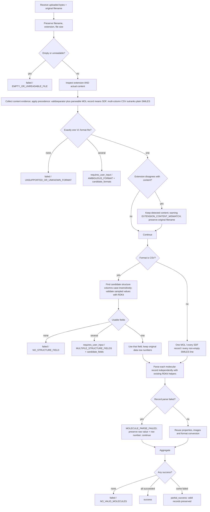

# Upload detection MVP (V1)

## Original visual proposal

The original workflow diagram is **[./image.png](./image.png)**. It is the
original visual proposal, not the complete technical specification. It shows
the basic chain (upload → empty/unreadable check → extension + content
inspection → format decision → CSV structure-column search → record reading →
per-record parsing → success / partial / failure). Where the PNG is incomplete,
the corrected workflow below and `chembridge/upload_workflow.py` are the source
of truth.

The diagram is stored **inside this Git repository** next to this document, so
a fresh clone contains it. The external copy that originally supplied the
diagram was kept in place and is not required by this implementation or by
this document.

## Corrected workflow

## Four result statuses

| Status | Meaning |
|---|---|
| `success` | Every non-empty molecular record was parsed successfully. |
| `partial_success` | At least one record succeeded and at least one record failed (or produced a material output warning). Valid results are kept. |
| `failed` | Empty/unreadable file, unsupported or unknown format, no structure field, or no molecular record could be parsed. |
| `requires_user_input` | Format is ambiguous (`AMBIGUOUS_FORMAT`) or several usable CSV structure columns exist (`MULTIPLE_STRUCTURE_FIELDS`). Nothing is selected silently. |

Counts returned once the record stage is reached: `total_records`,
`successful_records`, `failed_records`, `skipped_records`.

## V1 supported formats

1. **MOL** — `M  END`, `V2000`/`V3000`, RDKit MOL-block parse.
2. **SDF** — `$$$$` record separators, MOL block markers, sampled RDKit parse.
3. **CSV** — consistently readable delimited table, identifiable columns, at least one validated molecular structure column.
4. **Plain SMILES text** — non-empty text records whose sampled values parse as SMILES, and no stronger MOL/SDF/CSV evidence.

Candidate CSV structure columns (compared case-insensitively via
`io.normalize_header`): `smiles`, `canonical_smiles`, `isomeric_smiles`,
`inchi`, `mol`, `molblock`, `structure`. A matching name alone is not enough:
sampled non-empty values must parse with the appropriate RDKit parser.

## Deliberately excluded from V1

ZIP, PDF, Word, chemical structure image recognition, JSON, XLSX, PDB, MOL2,
remote database lookup, chemical-name-to-structure lookup,
CAS-number-to-structure lookup, job queues, cloud storage, and advanced
production security infrastructure. Also excluded from this V1 detection layer:
TSV/InChI/SELFIES/MOL2/PDB as *file formats* — the older general converter in
`chembridge/io.py` still supports them, but `process_upload` deliberately does
not.

## Key behaviour

- **The extension is not trusted by itself.** Only content evidence decides the
  format. If the extension disagrees with clearly detected content, processing
  continues with the detected content, `EXTENSION_CONTENT_MISMATCH` is added to
  `warnings`, and the original filename/extension are preserved (no silent
  rename).
- **SDF outranks MOL.** A valid `$$$$` separator together with a parseable
  MOL-block record is detected as SDF, even for a single record whose body also
  parses as one MOL. Without `$$$$`, a complete MOL block is detected as MOL.
  The filename extension never overrides this precedence; a disagreeing
  extension only produces `EXTENSION_CONTENT_MISMATCH`. `AMBIGUOUS_FORMAT` is
  returned only when two independent strong interpretations remain (for example
  a one-column `smiles` header file, which is both a CSV table and a plain-SMILES
  file with an optional header).
- **Ambiguous cases require user selection.** `AMBIGUOUS_FORMAT` returns
  `candidate_formats`; `MULTIPLE_STRUCTURE_FIELDS` returns `candidate_fields`.
  Resume by calling `process_upload` again with `selected_format` or
  `selected_field`. `app.py` keeps the uploaded bytes in `st.session_state`, so
  the user does not have to upload the file again. No job-management platform
  was added.
- **Each molecular record is processed independently.** Every record keeps
  `source_filename`, `source_record_number`, `selected_source_field`,
  `raw_structure_value` and `inferred_source_format`. A parse failure is
  returned as `MOLECULE_PARSE_FAILED` with a concise message; no stack trace
  reaches the UI, and invalid chemistry is never silently repaired.
- **Valid records are preserved when other rows fail.** Successful molecules
  reuse `chembridge.pipeline.properties` and, when `output_dir` is supplied,
  `chembridge.pipeline.convert_file` for 2D images, structure-format conversion
  and `export_errors` reporting. Optional output failures are reported
  separately in `warnings` without discarding the parsed molecule. No
  conversion is claimed to be lossless.

## Stable codes

Errors: `EMPTY_OR_UNREADABLE_FILE`, `UNSUPPORTED_OR_UNKNOWN_FORMAT`,
`AMBIGUOUS_FORMAT`, `NO_STRUCTURE_FIELD`, `MULTIPLE_STRUCTURE_FIELDS`,
`MOLECULE_PARSE_FAILED`, `NO_VALID_MOLECULES`.
Warning: `EXTENSION_CONTENT_MISMATCH`.

The repository had no error-code convention (only `InputError` text, CLI exit
codes 0/1/2 and manifest `complete|partial|failed`), so these were introduced
as a small typed layer in `chembridge/upload_models.py` and do not conflict
with the existing converter's behaviour.

## Known limitations

- The PNG is a visual proposal only; its small labels were not transcribed.
- A single-record SDF with `$$$$` is decisively SDF, not `AMBIGUOUS_FORMAT`.
  Genuine ambiguity remains only for content with two independent strong
  interpretations, such as the one-column `smiles` header file (CSV vs plain
  SMILES).
- The external copy of the diagram was kept in place but is not required;
  the repository-local `./image.png` is the documented reference.
- Streamlit verification is programmatic (`AppTest`), not a real-browser test.
- Delimited text whose lines contain commas but no candidate column names is
  treated as a table and yields `NO_STRUCTURE_FIELD`, not plain SMILES.
- The `output_dir` path reuses `convert_file`, which requires a fresh
  `converted/` directory and therefore re-parses the file once; this is
  deliberate reuse rather than a second chemistry implementation.
